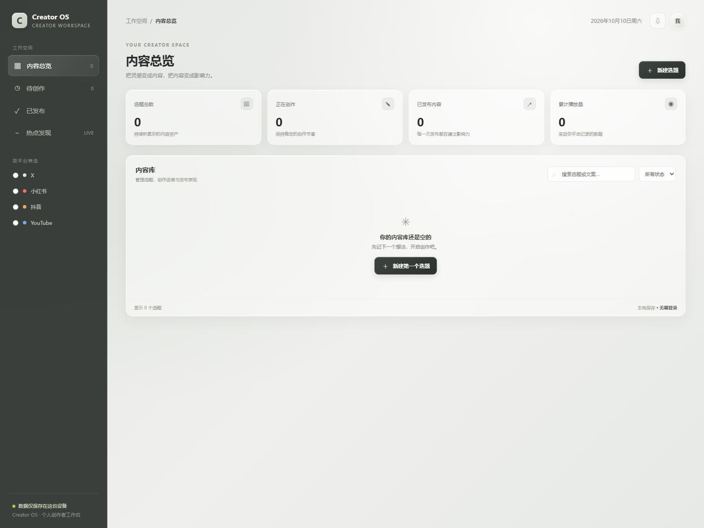

# Creator OS

面向个人创作者的本地内容运营工作台。第一版使用原生 HTML、CSS 和 JavaScript，不需要安装依赖、登录、数据库或付费 API。



## 运行方法

1. 将 `Creator-OS` 文件夹放在电脑上。
2. 双击 **`启动 Creator OS.bat`**，黑色命令窗口会显示服务已启动；请保持窗口打开。
3. 在浏览器访问 `http://localhost:8000`。
4. 点击「新建选题」，填写标题、平台、状态、文案或视频脚本，然后保存。

如果你熟悉 PowerShell，也可以在项目目录运行下面的命令：

```powershell
python -m http.server 8000 --bind 127.0.0.1
```

然后在浏览器打开 `http://localhost:8000`，并保持 PowerShell 窗口运行。关闭命令窗口后，网页服务会停止。

## 自动化测试

运行网页本身不需要 Node.js。运行自动化测试需要 Node.js 18 或更新版本；项目使用 Node.js 内置测试模块，不需要安装 npm 依赖。在项目目录运行：

```powershell
node --test tests/creator-os.test.cjs
```

## 页面截图

`screenshots/creator-os-overview.png` 是通过本地服务在 Microsoft Edge 中生成的真实页面截图。

## 功能

- 创建、编辑和删除选题。
- 热点发现页：快速打开微博、百度、知乎、B 站、小红书、抖音、X 与 Google Trends 的公开热点页面。
- 输入热点关键词后，可一键跳转到 X、小红书、抖音或 YouTube 搜索，也可预填平台并保存为待创作选题。
- 按 X、小红书、抖音和 YouTube 分类，并支持平台、状态和关键词筛选。
- 记录标题、文案、视频脚本和创作状态：未开始、创作中、已发布。
- 手动记录播放量、点赞、评论和收藏；总览展示选题数、创作中数量、已发布数量和累计播放量。
- 使用浏览器 `localStorage` 自动保存；顶部下载按钮可导出 JSON 备份。
- 中文界面，适配桌面和手机屏幕。

## 数据说明

数据只保存在当前浏览器的本地存储中。清理浏览器数据、换浏览器或换电脑不会自动同步，请定期使用右上角的下载按钮备份。导出的 JSON 目前用于留存备份，第一版没有导入功能。使用时请通过 `http://localhost:8000` 打开页面，以确保本地保存可用。

热点发现页提供的是各来源站的实时入口，点击后会跳转到来源站查看最新榜单；不同平台可能要求登录，榜单口径也不相同。此版本不抓取或缓存平台热度数据，因此不会显示虚构的热度值。YouTube 官方的趋势发现入口会因账号和地区有所不同；其公开趋势内容已逐步改为分类榜单，创作者也可在 YouTube Studio 的 Trends 中查看搜索需求。

## 许可证

本项目采用 [MIT License](LICENSE)，版权署名为 GitHub 用户 `Sevn-77`。

## 文件结构

```text
Creator-OS/
├── .github/
│   └── workflows/
│       └── tests.yml
├── .gitignore
├── docs/
│   ├── bug-log.md
│   └── test-report.md
├── screenshots/
│   └── creator-os-overview.png
├── tests/
│   └── creator-os.test.cjs
├── favicon.svg
├── index.html
├── LICENSE
├── GITHUB_RELEASE_CHECKLIST.md
├── 启动 Creator OS.bat
└── README.md
```
